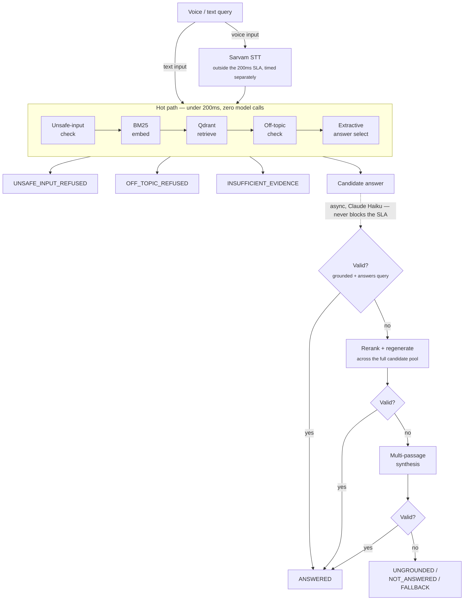

# Speculative RAG — Voice-Enabled Indic RAG

A retrieval-augmented QA system over [`ai4bharat/MSMARCO-XI`](https://huggingface.co/datasets/ai4bharat/MSMARCO-XI) (MS MARCO machine-translated into 14 Indic languages), scoped to Hindi, English, and Tamil. Voice query → Sarvam STT → BM25 sparse retrieval (Qdrant) → extractive answer, all inside a **<200ms hot-path SLA**, with an async LLM recovery chain (groundedness check → rerank+regenerate → multi-passage synthesis) layered on top whenever the fast answer doesn't hold up, reported separately and never counted against the SLA.

## How it works



- **Retrieval** is BM25 sparse term-frequency search (`sparse_embedding.py`), not a dense neural embedder in-process — deliberate, so the deployed webapp fits a free-tier 512MB host.
- **The hot path never calls a hosted LLM.** Answer generation is extractive (rank/select a passage or span across the top retrieved candidates), which is what makes the <200ms target hittable under real network conditions.
- **Async recovery** (`answer_orchestrator.py`) is the single control-flow owner for what happens when the fast answer fails validation: rerank+regenerate (one LLM call that both re-selects evidence across the whole candidate pool and answers from it) → re-validate → multi-passage synthesis as a final fallback. Every stage is folded into one `FinalAnswerStatus` (`answer_status.py`: `answered` / `not_answered` / `insufficient_evidence` / `ungrounded` / `fallback`) instead of leaving the caller to reconcile several independent verdicts.
- **The web UI renders this recovery chain as a live timeline** — the fast answer appears immediately, then "verifying → re-ranking & regenerating → synthesizing" steps fill in as the background recovery call progresses, each tagged with which engine (local heuristic vs. Claude Haiku) produced it.

## Project layout

| Path | Purpose |
|---|---|
| `src/speculative_rag/` | Core library — see breakdown below |
| `webapp/` | FastAPI app (`main.py`) + static frontend (`static/`) serving the pipeline over HTTP as a live recovery timeline |
| `scripts/` | CLIs for ingestion, interactive querying, and eval (recall@k, latency, answer quality, embedding-model A/B, rerank/synthesis recovery) |
| `tests/` | pytest suite covering every module in `src/speculative_rag/` and the webapp routes |
| `results/` | Eval outputs (recall@k per chunking strategy, latency percentiles, answer-quality reports) — local only, not tracked |

`src/speculative_rag/` breakdown:

| Module | Purpose |
|---|---|
| `pipeline.py` | The hot-path orchestrator — typed stages, per-stage timing, typed refusal exits, no model calls |
| `answer_orchestrator.py` | Owns the async recovery chain (validate → rerank+regenerate → synthesize) that runs after the hot path returns |
| `answer_status.py` | `FinalAnswerStatus` + `combine_verdict` — reconciles the hot-path outcome with the async LLM verdict into the one status shown to a user |
| `generation.py` | Extractive answer selection — best-matching sentence span across the top candidates, no model call |
| `chunking.py` | Passage-splitting strategies (native/sliding-window/sentence/metadata) used at ingestion |
| `guardrails.py` | Unsafe-input and off-topic heuristic checks |
| `answer_type.py` | Cheap expected-answer-type detection (numeric/yesno/person, en/hi/ta) used to disambiguate extractive candidates |
| `reflect.py` | Async LLM calls — groundedness check, rerank+regenerate, multi-passage synthesis (Claude Haiku) |
| `retrieval.py`, `sparse_embedding.py`, `embedding.py` | Qdrant retrieval, BM25 sparse embedding, optional dense embedding (eval-only) |
| `stt.py` | Sarvam speech-to-text |
| `indexing.py`, `data.py` | Corpus loading and Qdrant collection ingestion |
| `config.py` | Settings, language sources, Qdrant client construction |

## Setup

Requires Python 3.13+ and [`uv`](https://docs.astral.sh/uv/).

```bash
uv sync
```

Create a `.env` in the repo root (loaded automatically by `config.py`):

```
SARVAM_API_KEY=       # speech-to-text
ANTHROPIC_API_KEY=    # async validate/rerank/synthesis (Claude Haiku)
QDRANT_URL=           # unset -> falls back to local on-disk Qdrant at results/qdrant_local
QDRANT_API_KEY=
```

The `ai4bharat/MSMARCO-XI` dataset is not vendored — it's pulled separately (its own git/HF repo) into `MSMARCO-XI/` and is gitignored.

## Running

```bash
# Web UI (text + voice query, full pipeline + live recovery timeline)
uv run python -m scripts.serve_ui

# Interactive extractive-answer CLI over an existing collection
uv run python -m scripts.answer

# Voice-in CLI: audio file -> transcript -> pipeline answer
uv run python -m scripts.voice_answer path/to/audio.wav

# Interactive retrieval-only CLI over an already-built collection (no answer generation)
uv run python -m scripts.query
```

Optional dense-embedding extra (only needed for `run_embedding_model_eval.py` and dense-embedder tests — the deployed app doesn't use it):

```bash
uv sync --extra dense
```

## Evaluation

Each script in `scripts/run_*_eval.py` reproduces one table in `results/`:

- `run_recall_eval.py` — recall@k per chunking strategy vs. the dataset's gold `is_selected` labels (`chunking_comparison.md`)
- `run_latency_eval.py` / `run_full_latency_eval.py` — P50/P70/P100 latency, RAG-pipeline-only and the three-way STT/RAG/async-check split (`latency_rag.md`)
- `run_answer_quality_eval.py` — end-to-end answer quality against gold answers, per language
- `run_embedding_model_eval.py` — dense embedding model A/B (requires the `dense` extra)
- `run_llm_rerank_eval.py` — whether rerank+regenerate actually improves on the hot-path answer
- `run_synthesis_eval.py` — whether multi-passage synthesis recovers an answer on `INSUFFICIENT_EVIDENCE` queries

`scripts/ingest_production_corpus.py` builds the Qdrant collections these all run against; `scripts/benchmark.py` is a standalone timing harness.

## Testing

```bash
uv run pytest
```

Tests marked `slow` (in `pyproject.toml`) download models or hit local services — excluded by default in CI-style runs with `-m "not slow"` if needed.

## Deployment

`Dockerfile` + `render.yaml` deploy the webapp to Render's free tier (BM25-only, no in-process dense embedder, sized for 512MB RAM). Requires a separate Qdrant Cloud cluster — set `QDRANT_URL`/`QDRANT_API_KEY` in the Render dashboard; nothing is provisioned automatically.
