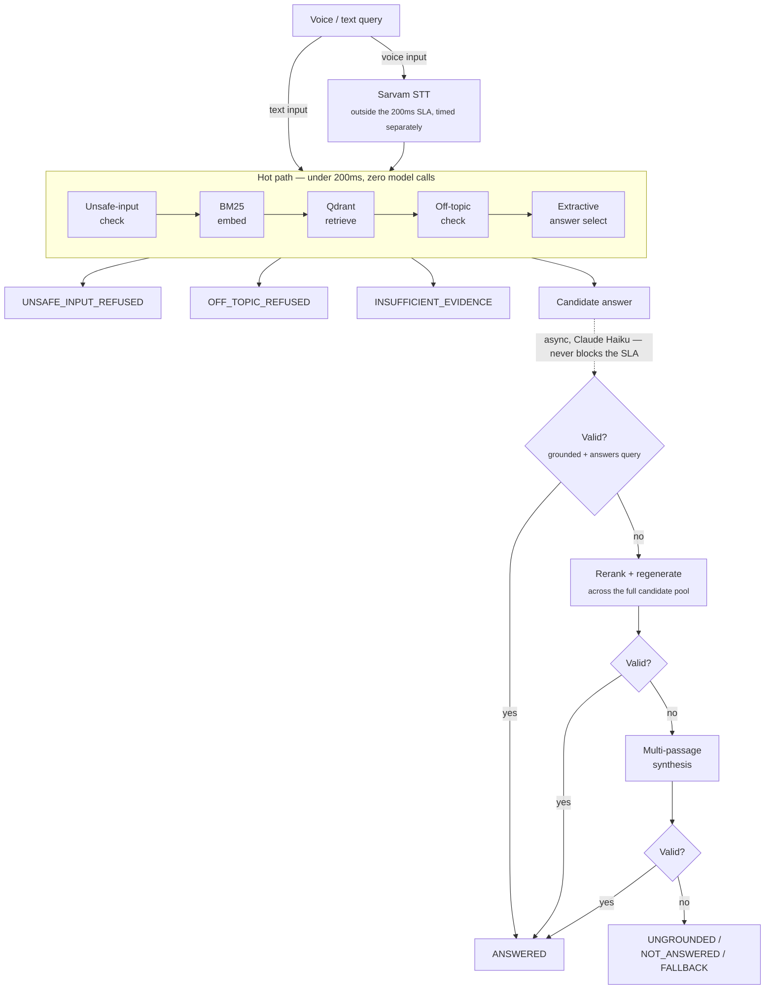

# Speculative RAG — Voice-Enabled Indic RAG

A retrieval-augmented QA system over [`ai4bharat/MSMARCO-XI`](https://huggingface.co/datasets/ai4bharat/MSMARCO-XI) (MS MARCO machine-translated into 14 Indic languages), scoped to Hindi, English, and Tamil. Voice query → Sarvam STT → BM25 sparse retrieval (Qdrant) → extractive answer, all inside a **<200ms hot-path SLA**, with an async LLM recovery chain (groundedness check → rerank+regenerate → multi-passage synthesis) layered on top whenever the fast answer doesn't hold up, reported separately and never counted against the SLA.

> **Naming note:** despite the name, this is not an implementation of the [Speculative RAG paper](https://arxiv.org/abs/2407.08223) (a smaller specialist LM drafts several candidate answers in parallel from different document subsets, a larger generalist LM verifies and picks one). There's no specialist/generalist LM pair and no parallel drafting here. The "speculative" part is closer to speculative *decoding*: the hot path always commits to a cheap, zero-LLM guess first (extractive span selection) and shows it immediately, and a slower LLM check — outside the SLA — runs after the fact and can overrule it.

## How it works



- **Retrieval** is BM25 sparse term-frequency search (`sparse_embedding.py`), not a dense neural embedder in-process — deliberate, so the deployed webapp fits a free-tier 512MB host.
- **The hot path never calls a hosted LLM.** Answer generation is extractive (rank/select a passage or span across the top retrieved candidates), which is what makes the <200ms target hittable under real network conditions.
- **Async recovery** (`answer_orchestrator.py`) is the single control-flow owner for what happens when the fast answer fails validation: rerank+regenerate (one LLM call that both re-selects evidence across the whole candidate pool and answers from it) → re-validate → multi-passage synthesis as a final fallback. Every stage is folded into one `FinalAnswerStatus` (`answer_status.py`: `answered` / `not_answered` / `insufficient_evidence` / `ungrounded` / `fallback`) instead of leaving the caller to reconcile several independent verdicts.
- **The web UI renders this recovery chain as a live timeline** — the fast answer appears immediately, then "verifying → re-ranking & regenerating → synthesizing" steps fill in as the background recovery call progresses, each tagged with which engine (local heuristic vs. Claude Haiku) produced it.

## Project layout

| Path | Purpose |
|---|---|
| `src/speculative_rag/` | Core library — see breakdown below |
| `webapp/` | FastAPI app (`main.py`) + static frontend (`static/`) serving the pipeline over HTTP as a live recovery timeline |
| `scripts/` | CLIs for ingestion, interactive querying, and eval (recall@k, latency, answer quality, embedding-model A/B, rerank/synthesis recovery) |
| `tests/` | pytest suite covering every module in `src/speculative_rag/` and the webapp routes |
| `results/` | Eval outputs (recall@k per chunking strategy, latency percentiles, answer-quality reports) — local only, not tracked |

`src/speculative_rag/` breakdown:

| Module | Purpose |
|---|---|
| `pipeline.py` | The hot-path orchestrator — typed stages, per-stage timing, typed refusal exits, no model calls |
| `answer_orchestrator.py` | Owns the async recovery chain (validate → rerank+regenerate → synthesize) that runs after the hot path returns |
| `answer_status.py` | `FinalAnswerStatus` + `combine_verdict` — reconciles the hot-path outcome with the async LLM verdict into the one status shown to a user |
| `generation.py` | Extractive answer selection — best-matching sentence span across the top candidates, no model call |
| `chunking.py` | Passage-splitting strategies (native/sliding-window/sentence/metadata) used at ingestion |
| `guardrails.py` | Unsafe-input and off-topic heuristic checks |
| `answer_type.py` | Cheap expected-answer-type detection (numeric/yesno/person, en/hi/ta) used to disambiguate extractive candidates |
| `reflect.py` | Async LLM calls — groundedness check, rerank+regenerate, multi-passage synthesis (Claude Haiku) |
| `retrieval.py`, `sparse_embedding.py`, `embedding.py` | Qdrant retrieval, BM25 sparse embedding, optional dense embedding (eval-only) |
| `stt.py` | Sarvam speech-to-text |
| `indexing.py`, `data.py` | Corpus loading and Qdrant collection ingestion |
| `config.py` | Settings, language sources, Qdrant client construction |

## Setup

Requires Python 3.13+ and [`uv`](https://docs.astral.sh/uv/).

```bash
uv sync
```

Create a `.env` in the repo root (loaded automatically by `config.py`):

```
SARVAM_API_KEY=       # speech-to-text
ANTHROPIC_API_KEY=    # async validate/rerank/synthesis (Claude Haiku)
QDRANT_URL=           # unset -> falls back to local on-disk Qdrant at results/qdrant_local
QDRANT_API_KEY=
```

The `ai4bharat/MSMARCO-XI` dataset is not vendored — it's pulled separately (its own git/HF repo) into `MSMARCO-XI/` and is gitignored.

## Running

```bash
# Web UI (text + voice query, full pipeline + live recovery timeline)
uv run python -m scripts.serve_ui

# Interactive extractive-answer CLI over an existing collection
uv run python -m scripts.answer

# Voice-in CLI: audio file -> transcript -> pipeline answer
uv run python -m scripts.voice_answer path/to/audio.wav

# Interactive retrieval-only CLI over an already-built collection (no answer generation)
uv run python -m scripts.query
```

Optional dense-embedding extra (only needed for `run_embedding_model_eval.py` and dense-embedder tests — the deployed app doesn't use it):

```bash
uv sync --extra dense
```

## Evaluation

Each script in `scripts/run_*_eval.py` reproduces one table in `results/`:

- `run_recall_eval.py` — recall@k per chunking strategy vs. the dataset's gold `is_selected` labels (`chunking_comparison.md`)
- `run_latency_eval.py` / `run_full_latency_eval.py` — P50/P70/P100 latency, RAG-pipeline-only and the three-way STT/RAG/async-check split (`latency_rag.md`)
- `run_answer_quality_eval.py` — end-to-end answer quality against gold answers, per language
- `run_embedding_model_eval.py` — dense embedding model A/B (requires the `dense` extra)
- `run_llm_rerank_eval.py` — whether rerank+regenerate actually improves on the hot-path answer
- `run_synthesis_eval.py` — whether multi-passage synthesis recovers an answer on `INSUFFICIENT_EVIDENCE` queries

`scripts/ingest_production_corpus.py` builds the Qdrant collections these all run against; `scripts/benchmark.py` is a standalone timing harness.

## Testing

```bash
uv run pytest
```

Tests marked `slow` (in `pyproject.toml`) download models or hit local services — excluded by default in CI-style runs with `-m "not slow"` if needed.

## Tradeoffs, and what scaling this up would take

**Why this shape**

- Latency is bounded and predictable — the hot path touches no third-party API, so its tail latency is governed by local BM25 scoring plus one Qdrant round trip, not by an LLM provider's own tail latency.
- It degrades gracefully — if the Anthropic API is slow, rate-limited, or down, the fast extractive answer still returns; only the "is this actually right" confirmation is missing, not the answer itself.
- It's cheap to run at rest — no dense embedding model in-process (`sparse_embedding.py`, BM25 only) keeps the deployed instance inside a free-tier 512MB host with zero GPU.
- The branching logic is deterministic and unit-testable — `generation.py`'s extractive selection is pure Python with no model call, so `pipeline.py`/`answer_orchestrator.py` are tested with fakes instead of mocked LLM responses.

**What it costs**

- It doesn't save LLM spend, only latency. `webapp/main.py`'s `post_answer` always schedules the recovery chain in the background, and `answer_orchestrator.resolve_recovery` always runs a groundedness check on every request that reaches `ANSWERED` — so LLM cost still scales linearly with query volume. Only the deeper rerank+regenerate/synthesis calls are conditional on that cheap check failing.
- The fast path has a hard quality ceiling. Extractive selection can only return a verbatim span already present in one retrieved passage — it can't synthesize across passages or rephrase — so the first answer a user sees is sometimes wrong on multi-hop or not-verbatim-in-any-single-passage queries, until (if) recovery resolves it.
- The displayed answer can flip after the fact. The web UI shows the fast answer immediately, then updates `final_status` — and sometimes the answer text itself — once the async chain resolves; something that looked `ANSWERED` for a second can become `UNGROUNDED` or get replaced by a synthesized answer. That's a real UX cost paid for lower perceived latency.
- Retrieval quality is bounded by BM25 lexical overlap. There's no semantic matching, so paraphrased or vocabulary-mismatched queries recall worse than a dense/hybrid retriever would — `run_embedding_model_eval.py` exists specifically to measure that gap.

**What scaling past a single free-tier instance would need**

- `_PENDING_ANSWERS` (`webapp/main.py`) is an in-memory `OrderedDict` on one process, and the two-phase `/api/answer` → poll `/api/answer/{request_id}` flow only works because there's exactly one replica. More than one uvicorn worker or Render instance needs that moved to a shared store (Redis, a DB row) any replica can read.
- The recovery chain runs via `asyncio.to_thread` + FastAPI `BackgroundTasks` inside the same process — fine at low QPS, but it has no retry, no backpressure against Anthropic's rate limits, and drops in-flight work if the process restarts. A loaded deployment would want a real task queue (Celery/RQ or similar) instead.
- `SparseEmbedder`/`Retriever` are loaded once per language at startup as module globals (`_load_state`) — every replica pays that load cost independently, and the local file-based Qdrant client (the no-`QDRANT_URL` branch of `get_qdrant_client`) doesn't support concurrent multi-process access at all, so production already requires Qdrant Cloud. The `~175ms REST` figure in `config.py`'s comment was measured cross-region and isn't representative of the deployed setup — the Render webapp and the Qdrant Cloud cluster are co-located in the same region specifically to cut that network cost out of the hot path, and observed production latency is well under budget (extractive answers landing in the tens of ms, not hundreds). That headroom disappears again if a future replica or Qdrant cluster move breaks the co-location, so it's worth keeping region-pinned deliberately rather than by accident.
- Nothing is cached today. Identical or near-identical queries re-run BM25 retrieval and re-pay the LLM groundedness check every time. Caching groundedness verdicts, or skipping the check above some retrieval-score/answer-type confidence threshold, is the most direct lever for cutting both latency and LLM cost at real volume — neither is implemented yet.
- Growing past hi/en/ta means adding a `LanguageSource` in `config.py` and validating that BM25's per-language tokenizer/stemmer setup (`sparse_embedding.py`) actually produces reasonable stems for the new language — stemming quality varies a lot across Indic languages and there's no generic fallback if it doesn't.

## Deployment

`Dockerfile` + `render.yaml` deploy the webapp to Render's free tier (BM25-only, no in-process dense embedder, sized for 512MB RAM). Requires a separate Qdrant Cloud cluster — set `QDRANT_URL`/`QDRANT_API_KEY` in the Render dashboard; nothing is provisioned automatically.
